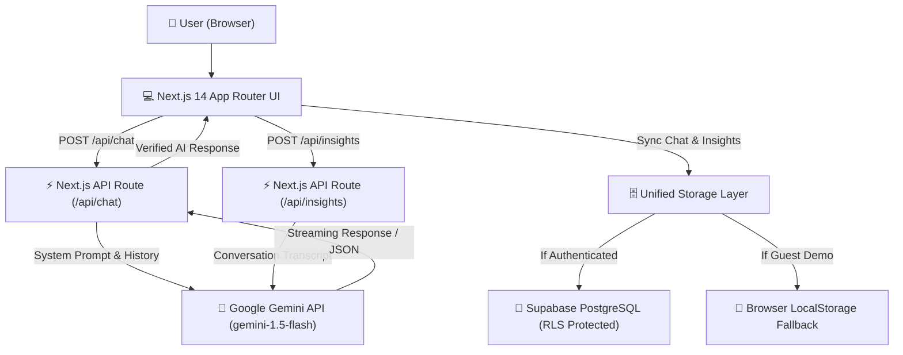

# TimeTalk AI — Chat with History

> **"History Isn't Silent. Ask It Anything."**  
> An educational, responsive, production-quality web application that lets users hold authentic, contextual dialogues with the world's most influential historical figures powered by Google's Gemini API, Next.js 14 App Router, Tailwind CSS, and Supabase.

---

## 🏛️ 1. Project Overview

**TimeTalk AI** transforms static history into an interactive, pedagogical museum experience. Users can converse with figures across over 2,500 years of human thought—from Classical Antiquity through the Renaissance, Industrial Revolution, and Modern Era.

Every historical persona is simulated with strict adherence to documented writings, verified biographies, and temporal boundaries (preventing modern anachronisms and distinguishing documented historical facts from educational simulation).

---

## ✨ 2. Key Features

- **🏛️ 10 Curated Historical Personas:**
  1. **Albert Einstein** — Theoretical Physics, Relativity & Philosophy of Science
  2. **Marie Curie** — Radioactivity, Chemistry & Laboratory Diligence
  3. **Leonardo da Vinci** — Renaissance Polymath, Fine Art & Mechanical Engineering
  4. **Aristotle** — Classical Logic, Virtue Ethics & Natural Sciences
  5. **Cleopatra VII** — Statesmanship, Diplomacy, Polyglot Leadership & Naval Strategy
  6. **Abraham Lincoln** — 19th Century Constitutional Law & American Union
  7. **Ada Lovelace** — Computational Theory & "Poetical Science"
  8. **A.P.J. Abdul Kalam** — Aerospace Engineering, SLV-III & Youth Mentorship
  9. **Mahatma Gandhi** — Satyagraha, Nonviolence (Ahimsa) & Moral Self-Rule
  10. **Nikola Tesla** — AC Electricity, Wireless Transmission & Electromagnetism

- **💬 Dynamic Multi-Turn AI Chat:**
  - Real Google Gemini API integration (`gemini-1.5-flash`) via server-side Next.js route `/api/chat`.
  - Persona system instruction dynamic priming with lifespan, historical context, and pedagogical rules.
  - Temporal boundary safeguards: personas acknowledge when inquired about events after their deaths.
  - Interactive starter questions tailored to each persona.
  - Keyboard shortcuts (`Enter` to send, `Shift+Enter` for multiline input).
  - Copy response buttons and error retry handlers.

- **📜 AI History Insights Generator (`/api/insights`):**
  - Generates a concise discussion summary.
  - 5 verified historical facts.
  - 3 core educational takeaways.
  - Chronological timeline milestones.
  - 3 recommended follow-up questions.
  - **"Fact vs. Interpretation"** breakdown contrasting documented archival facts against creative conversational framing.
  - One-click export to Markdown (`.md`).

- **📊 User Dashboard & Analytics:**
  - Real metrics: total conversations, figures explored, bookmarks, and completion progress.
  - Interactive Recharts visualization showing distribution across historical eras.
  - Recent dialogues and personalized recommendations for unreached thinkers.

- **🔍 Searchable & Filterable Explorer:**
  - Full-text search across names, discoveries, eras, and biographies.
  - Multi-attribute filtering by Historical Era, Field of Expertise, and Geographic Region.
  - Favorite / bookmark toggle saved locally or to Supabase.

- **💾 Unified Persistence & Dual Mode:**
  - **Supabase PostgreSQL & Auth:** Full Row Level Security (RLS) policies for user data isolation.
  - **Zero-Friction Guest Mode:** Works out of the box using structured browser storage so judges and users can test without mandatory registration.

- **📤 Data Export:**
  - Export any conversation thread as `.md` or `.txt`.
  - Export History Insights reports.

---

## 🛠️ 3. Technology Stack

| Layer | Technology | Purpose |
|---|---|---|
| **Frontend Framework** | Next.js 14 (App Router) | Server-side rendering, streaming, and modern routing |
| **Language** | TypeScript 5.8 | Strict type safety and maintainable contracts |
| **Styling** | Tailwind CSS & PostCSS | Museum dark theme (deep navy, charcoal, gold accents) |
| **Icons & UI** | Lucide React | Modern, accessible iconography |
| **Data Visualization** | Recharts | Era distribution analytics in User Dashboard |
| **AI Integration** | Google Gemini API (`@google/generative-ai`) | Real multi-turn chat and structured insight synthesis |
| **Validation** | Zod 3.24 | Strict schema validation on API payloads |
| **Database & Auth** | Supabase (PostgreSQL + RLS) | Cloud database and user isolation |
| **Hosting** | Vercel | Production-ready edge deployment |

---

## 🏗️ 4. System Architecture & Data Flow



---

## 🚀 5. Getting Started Locally

### Prerequisites
- **Node.js**: v18.18+ or v20+ (`node -v`)
- **npm** or **pnpm**
- **Google Gemini API Key** (Free tier available at [Google AI Studio](https://aistudio.google.com/))
- *(Optional)* **Supabase Project** (Free tier available at [supabase.com](https://supabase.com/))

### Installation Steps

1. **Clone the repository:**
   ```bash
   git clone https://github.com/your-username/timetalk-ai.git
   cd timetalk-ai
   ```

2. **Install dependencies:**
   ```bash
   npm install
   ```

3. **Configure Environment Variables:**
   Copy `.env.example` to `.env.local`:
   ```bash
   cp .env.example .env.local
   ```
   Open `.env.local` and add your Gemini API Key:
   ```env
   # Google Gemini API Key
   GEMINI_API_KEY=AIzaSy...your_actual_key_here

   # Supabase Credentials (Optional for Guest Mode; Required for Cloud DB)
   NEXT_PUBLIC_SUPABASE_URL=https://your-project-id.supabase.co
   NEXT_PUBLIC_SUPABASE_ANON_KEY=your_supabase_anon_key_here
   ```

4. **Run the local development server:**
   ```bash
   npm run dev
   ```
   Open [http://localhost:3000](http://localhost:3000) in your browser.

---

## 🗄️ 6. Supabase Database Setup

If you wish to enable cloud persistence and user authentication:

1. Create a new project in the [Supabase Dashboard](https://supabase.com/dashboard).
2. Navigate to the **SQL Editor** in your Supabase dashboard.
3. Open `supabase/migrations/001_initial_schema.sql` from this repository, paste the contents, and click **Run**.
4. Open `supabase/seed.sql`, paste the contents, and click **Run** to populate the 10 historical personas.
5. In your Supabase Project Settings -> API, copy:
   - `Project URL` → `NEXT_PUBLIC_SUPABASE_URL`
   - `anon public` key → `NEXT_PUBLIC_SUPABASE_ANON_KEY`
6. Add these keys to your `.env.local`.

---

## 🧪 7. Running Tests

Run the built-in test suite to verify data integrity, Zod validation schemas, temporal instructions, and export utilities:

```bash
node --test test/api-and-logic.test.mjs
```

---

## 🌐 8. Deployment to Vercel

1. Push your repository to GitHub.
2. Go to [Vercel](https://vercel.com/) and click **"Add New Project"**.
3. Import your GitHub repository.
4. In the **Environment Variables** section, add:
   - `GEMINI_API_KEY`: Your Gemini API key.
   - `NEXT_PUBLIC_SUPABASE_URL`: (Optional) Your Supabase URL.
   - `NEXT_PUBLIC_SUPABASE_ANON_KEY`: (Optional) Your Supabase Anon Key.
5. Click **Deploy**. Vercel will build and deploy the production bundle automatically.

---

## 🛡️ 9. Ethical AI & Educational Disclaimers

- **Pedagogical Simulation:** TimeTalk AI generates dialogue using Google Gemini trained on documented historical literature, papers, and biographies.
- **Not Verbatim Quotes:** Generated dialogue is an educational simulation based on documented historical records and writings. It must not be cited as authentic historical quotations.
- **Temporal Boundaries:** Historical figures acknowledge events that took place after their lifetime rather than fabricating modern memories.
- **Fact vs. Simulation Transparency:** The built-in **History Insights** tool provides explicit distinction between documented historical facts and creative conversational framing.

---

## 📄 License
MIT License. Built for educational exploration and the AI & Machine Learning Hackathon.
